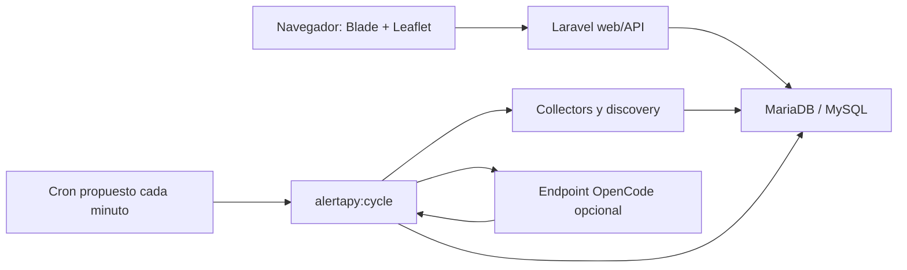

# Arquitectura

## Alcance actual

AlertaPY es un monolito Laravel 12. PHP atiende HTML y JSON; MariaDB conserva catálogos, evidencia e incidencias; Blade entrega la pantalla; JavaScript vanilla controla Leaflet. No existe una capa Node ni un servicio residente.

Los collectors activos guardan evidencia y los proveedores discovery nunca publican automáticamente. `CorroborationService` enlaza evidencia independiente al mismo incidente y OpenCode continúa siendo un árbitro editorial opcional con fallback `WAIT`.

## Capas

- `app/Enums`: vocabularios cerrados para fuente, estado, severidad y precisión.
- `app/Models`: persistencia y relaciones del dominio.
- `app/Services`: reglas reutilizables; hoy contiene la consulta filtrada de incidencias.
- `app/Http/Requests`: validación y normalización de entradas.
- `app/Http/Resources`: lista explícita de campos públicos.
- `app/Http/Controllers`: coordinación HTTP, sin lógica editorial.
- `database`: migraciones e inicialización de catálogos.
- `resources/views` y `public`: experiencia web sin build.

## Flujo público de Fase 1

1. Blade carga las categorías habilitadas.
2. Leaflet muestra OpenStreetMap centrado en Paraguay.
3. El navegador consulta `/api/incidents` con el periodo, capas y límites visibles.
4. Laravel valida los filtros y consulta solo filas publicadas.
5. Los resources convierten enums y relaciones a un JSON público acotado.
6. El navegador dibuja puntos y clusters; las líneas y polígonos requieren GeoJSON real y las estaciones usan una API separada. Si no hay datos, mantiene el mapa vacío.
7. Cada 60 segundos se repite la consulta sin recargar la página.

## Modelo de datos

- `categories` clasifica incidencias sin condicionar su fuente.
- `sources` define institución o medio, frecuencia y metadatos HTTP.
- `source_runs` audita ejecuciones futuras.
- `raw_items` conserva evidencia original y hash.
- `content_candidates` prepara el flujo automático posterior.
- `incidents` contiene la vista territorial publicable.
- `incident_sources` permite varias referencias para un mismo hecho.
- `incident_updates` forma la línea de tiempo.
- `monitoring_stations` y `station_measurements` conservan series sin convertirlas en noticias.
- `locations` conserva nombre canónico, jerarquía, ciudad, departamento, precisión, consulta geográfica y coordenadas.
- `location_aliases` permite detectar abreviaturas y nombres alternativos directamente en el texto recolectado.
- `geocoding_cache` evita consultas externas repetidas.

## Compatibilidad compartida

- PHP mínimo declarado: 8.2.
- Dependencias resueltas por Composer 2.
- Producción en MariaDB/MySQL.
- Cache y sesiones en base de datos.
- Cola síncrona; sin worker.
- Activos estáticos; sin npm o Vite.
- Automatización mediante `alertapy:cycle`, fuentes vencidas prioritarias, límites cooperativos, checkpoint de la cola general y lock. El runner local despierta cada 60 segundos por defecto; el cron de producción cada minuto sigue pendiente de configurar y probar en Hostinger.

## Límites de confianza

La API nunca publica por el mero hecho de existir una fila. Exige `published_at`. La evidencia cruda no se serializa. Las decisiones futuras de OpenCode serán sugerencias editoriales estrictas: PHP seguirá aplicando integridad, seguridad, dominios permitidos y límites geográficos antes de persistir cambios públicos.
